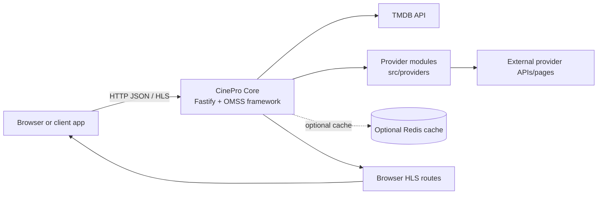

# CinePro Core

CinePro Core is a TypeScript/Node.js backend that exposes an OMSS-compatible
HTTP API for resolving movie and TV episode sources through auto-discovered
provider integrations. It also provides browser-oriented HLS routes that proxy
and rewrite nested playlists and media URLs.

> **Use and legal notice:** This project is intended for personal, lawful use.
> Provider availability, permissions, and content rights vary by jurisdiction
> and service. You are responsible for complying with applicable law and
> third-party terms.

## Features

- Movie and TV episode source resolution by TMDB ID.
- Auto-discovered provider modules under `src/providers/`.
- In-memory caching by default, with optional Redis caching.
- CORS configuration for browser clients.
- Optional native Stremio addon and MCP integrations.
- Browser-friendly HLS routes with nested playlist and segment proxying.
- TypeScript strict mode and a Node.js production build.

## Screenshots

Screenshots are not currently included. Contributions adding screenshots of a
local development setup are welcome.

## Architecture

CinePro Core is a backend service. A frontend such as Niho is a separate
client and is not included in this repository.



Core obtains metadata and source information from TMDB and provider
integrations. It does not include a catalog database, user accounts, or
server-side user library storage. The provider modules are independent
integrations and may stop working when an external service changes.

## Recommended frontend: Niho

For a complete user experience, pair CinePro Core with the
[Niho frontend](https://github.com/numan259/niho). Niho is the client
application that provides the user interface for browsing titles, viewing
details, selecting episodes, and starting playback through Core.

CinePro Core and Niho have separate responsibilities:

- **CinePro Core** handles TMDB metadata, provider discovery, source
  resolution, and browser-compatible HLS streaming.
- **Niho** provides the web and Android user interface that people use to
  search, browse, and watch content.

Core can be used by other clients, but Niho is important because it connects
the backend capabilities to an accessible, consistent viewing experience.
Using both projects also keeps the backend and frontend concerns separate, so
developers can self-host, customize, or replace either component independently.

To connect Niho to a local Core server, configure the frontend's
`VITE_CINEPRO_URL` value in its local `.env` file. For example:

```text
VITE_CINEPRO_URL=http://localhost:3000
```

When Core runs on another trusted device, use that device's reachable address
instead. See the [Niho repository](https://github.com/numan259/niho) for its
frontend and Android setup instructions.

## Prerequisites

- Node.js 20 or newer. Node.js 22 is recommended because it matches the
  included Dockerfile.
- npm.
- A TMDB API key.
- Optional: Redis 7 or newer when `CACHE_TYPE=redis`.
- Optional: Docker and Docker Compose for the included Compose configuration.

Supported operating systems include Windows, macOS, and Linux anywhere the
required Node.js runtime and npm are available.

For local development, a typical modern desktop or small server is sufficient.
Resource usage depends on the number of concurrent requests and external
providers; no specific hardware minimum has been established.

## Installation

### 1. Clone and install

```bash
git clone https://github.com/numan259/cinepro.git
cd core
npm ci
```

Use `npm install` instead of `npm ci` if you intentionally need npm to update
the lockfile.

### 2. Configure the environment

Linux/macOS:

```bash
cp .env.example .env
```

Windows PowerShell:

```powershell
Copy-Item .env.example .env
```

Edit `.env` and set `TMDB_API_KEY` to your own key. Never commit `.env`.

### 3. Start development mode

```bash
npm run dev
```

The default address is `http://localhost:3000`. Press `Ctrl+C` to stop the
development process.

### 4. Build and start the compiled server

```bash
npm run build
npm start
```

`npm start` builds before starting `dist/server.js`. Stop it with `Ctrl+C` or
the normal process-management command for your operating system.

## Configuration

See [docs/CONFIGURATION.md](docs/CONFIGURATION.md) for the complete variable
reference. The short version is:

| Variable         | Default     | Purpose                                                            |
| ---------------- | ----------- | ------------------------------------------------------------------ |
| `PORT`           | `3000`      | HTTP port.                                                         |
| `HOST`           | `localhost` | Bind address. Use `0.0.0.0` only when another device must connect. |
| `NODE_ENV`       | unset       | Runtime environment label.                                         |
| `PUBLIC_URL`     | unset       | Public base URL used by framework integrations.                    |
| `TMDB_API_KEY`   | none        | Required TMDB credential.                                          |
| `CACHE_TYPE`     | `memory`    | `memory` or `redis`.                                               |
| `REDIS_HOST`     | `localhost` | Redis hostname when Redis caching is selected.                     |
| `REDIS_PORT`     | `6379`      | Redis port.                                                        |
| `REDIS_PASSWORD` | empty       | Optional Redis password.                                           |
| `CORS_ORIGIN`    | `*`         | Allowed browser origin configuration.                              |
| `STREMIO_ADDON`  | `false`     | Enables the framework's native Stremio addon.                      |
| `MCP_ENABLED`    | `false`     | Enables MCP integration.                                           |

`TMDB_CACHE_TTL` and `INTERNAL_DEBUG` are retained in `.env.example` for
compatibility with the OMSS ecosystem and existing project workflows. Their
behavior depends on the framework/provider version in use.

## API and browser playback

The framework API includes:

```text
GET /v1/movies/:tmdbId
GET /v1/tv/:tmdbId/seasons/:season/episodes/:episode
```

For browser HLS playback, use:

```text
GET /streams/movie/:tmdbId/master.m3u8
GET /streams/tv/:tmdbId/:season/:episode/master.m3u8
```

These stable routes validate candidate sources, select a playable source, and
proxy nested HLS playlists and segments. Browsers without native HLS support
need an HLS-capable player such as hls.js.

## Redis with Docker Compose

The included [compose.yml](compose.yml) runs Core and Redis together:

```bash
docker compose up --build
```

Set `TMDB_API_KEY` in the shell or an environment file before starting Compose.
The Compose file publishes Core on port `3000` and Redis on port `6379`.
Redis should not be exposed outside a trusted network.

Stop the Compose services with:

```bash
docker compose down
```

Docker is optional; it is not required for local development.

## Development

Useful commands:

```bash
npm run dev       # TypeScript watch server
npm run build     # Type-check and emit dist/
npm run format    # Format src/
npm run clean     # Remove dist/
```

Providers are discovered from `src/providers/` at startup. See
[CONTRIBUTING.md](CONTRIBUTING.md) for provider conventions and testing
guidance.

## Troubleshooting

See [docs/TROUBLESHOOTING.md](docs/TROUBLESHOOTING.md) for detailed guidance.

Common checks:

1. Confirm `.env` exists and contains your own `TMDB_API_KEY`.
2. Confirm port `3000` is available.
3. Use `HOST=0.0.0.0` only when connecting from another device on a trusted
   network.
4. Configure `CORS_ORIGIN` for the actual frontend origin instead of `*` when
   appropriate.
5. Remember that providers are external integrations; a missing or invalid
   source may be provider-specific.

## Security

- Keep `.env`, API keys, Redis passwords, and logs out of Git.
- Do not expose Core directly to the public Internet without HTTPS,
  authentication/authorization, rate limiting, and monitoring.
- Restrict CORS in deployments with a known frontend origin.
- Do not expose Redis publicly.
- Review provider terms and content rights before enabling or distributing an
  integration.

See [SECURITY.md](SECURITY.md) for reporting and operational guidance.

## Contributing

Read [CONTRIBUTING.md](CONTRIBUTING.md), run the documented validation commands,
and include reproducible test details in pull requests.

## Licensing and acknowledgements

This is a modified project derived from CinePro Core. Original and modified
components are distributed under the PolyForm Noncommercial License 1.0.0;
see [LICENSE](LICENSE) and [NOTICE](NOTICE).

Required Notice: Copyright CinePro Foundation
(https://github.com/cinepro-org)

This repository is not an official CinePro Foundation repository unless
explicitly stated by the repository owner. The license permits noncommercial
use and distribution subject to its terms; it does not grant commercial rights
or permit removing the original attribution.

This repository depends on third-party packages listed in
[package.json](package.json), including `@omss/framework`, Fastify through the
framework, Cheerio, CryptoJS, dotenv, TypeScript, and related type/build
packages. Their licenses remain with their respective authors. Review the
package metadata and lockfile before redistributing a build.

TMDB, provider services, and any external media services are independent
services. CinePro Core is not TMDB, Rakuten, YouTube, or any provider brand and
does not grant rights to third-party content.
