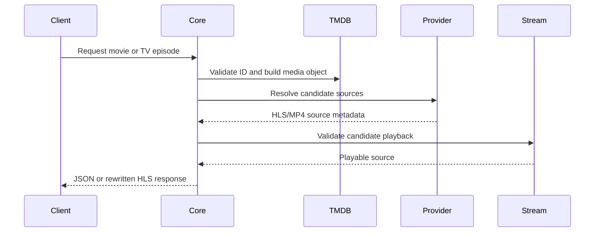

# Architecture

## Runtime components

Core is a Node.js application written in TypeScript. `src/server.ts` creates an
`OMSSServer`, loads environment configuration with `dotenv`, discovers provider
modules, registers the custom browser stream routes, and starts the HTTP
server.

The OMSS framework supplies the base HTTP API, provider registry, TMDB service,
cache abstraction, proxy service, and optional Stremio/MCP integrations.

## Request flow

Providers are external integrations, not databases owned by Core. Their
availability and behavior can change independently of this repository.

## Persistence

There is no application database. The default cache is in memory and is lost
when the process stops. Redis is optional and is configured through
`CACHE_TYPE`, `REDIS_HOST`, `REDIS_PORT`, and `REDIS_PASSWORD`.

## Network surface

- Default HTTP server: `localhost:3000`.
- Browser routes: `/streams/movie/:id/master.m3u8` and
  `/streams/tv/:id/:season/:episode/master.m3u8`.
- Optional framework routes include `/v1/movies/...`, `/v1/tv/...`,
  `/stremio/...`, and MCP routes when enabled.
